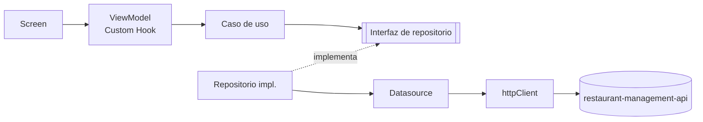

# Arquitectura de la app móvil

Clean Architecture por features + MVVM, acordada en pareja (Irving y José) en la tarea #310.

## Estructura

```text
src/
├── core/                         # Compartido por todas las features, sin lógica de negocio
│   ├── config/env.ts             # Variables EXPO_PUBLIC_* (todo lo de aquí va en el bundle)
│   ├── errors/AppError.ts        # Error de la app, independiente de HTTP
│   ├── http/httpClient.ts        # Singleton: única instancia que habla con el API e inyecta el JWT
│   ├── di/                       # Dependency Injection: grafo de dependencias + Context/Provider
│   ├── providers/AppProviders.tsx# QueryClientProvider + DependenciesProvider
│   └── monitoring/               # Sentry con filtrado de datos sensibles
├── shared/presentation/components/   # Componentes reutilizables (Card, ListItem, ...)
└── features/
    └── <feature>/                # auth, menu, reservations, orders, notifications, admin
        ├── domain/               # entities/, repositories/ (interfaces), usecases/
        ├── data/                 # datasources/, dtos/, mappers/, repositories/ (implementaciones), gateways/
        └── presentation/         # screens/, components/, viewmodels/ (Custom Hooks)
```

## Regla de dependencias



- `presentation → domain ← data`. El dominio no importa nada de `data/` ni de `presentation/`.
- `domain/` no importa React, Expo, `fetch` ni SDKs externos (Stripe, Expo Notifications). Así los
  casos de uso se prueban con Jest sin mocks de librerías.
- Un **Screen** solo renderiza y llama a su **ViewModel**. Nunca importa un caso de uso, un
  repositorio ni `httpClient` directamente.
- Un **ViewModel** es un Custom Hook (`useLogin`, `useMenu`, ...). Obtiene los casos de uso con
  `useDependencies()` y usa React Query (datos del servidor) o Zustand (estado local).
- Los **DTOs** (forma del JSON del API) no salen de `data/`. El **mapper** los convierte en
  entidades de dominio y descarta los campos que la app no necesita.
- Los errores llegan a dominio y presentación como `AppError` (`kind`: `unauthorized`,
  `validation`, `network`, ...), nunca como `Response` ni como códigos HTTP sueltos.

## Manejo global de errores HTTP

`httpClient` es el único lugar que traduce errores HTTP. Los datasources, hooks y pantallas no
revisan códigos de estado: reciben un `AppError` con un mensaje listo para mostrar.

| Respuesta | Qué hace la app |
|---|---|
| 401 en una petición **con** token | La sesión venció o se revocó: llama al manejador que registra `createDependencies()`, que borra la sesión de SecureStore, limpia el pedido en curso y la caché de React Query, y vuelve al Login con el aviso "Tu sesión expiró". |
| 401 **sin** token | Es el login con credenciales malas; `AuthRepositoryImpl` pone el mensaje genérico. |
| 403 | Respeta el mensaje propio del API; el "Forbidden resource" del `RolesGuard` se cambia por "No tienes permiso para realizar esta acción". |
| 5xx | Mensaje genérico: nunca se muestran detalles internos del servidor. |
| Red caída / tiempo límite | `AppError` `network` / `timeout`. |

- React Query reintenta una vez solo lo pasajero (`network`, `timeout`, `server`); un 4xx no se
  repite (`isRetryable`).
- En los ViewModels el texto se obtiene con `userMessage(error, 'mensaje de la feature')`: si el
  error no es un `AppError` (un bug), se muestra el mensaje de la feature y no el del error.
- Un repositorio puede dar un mensaje más específico para su caso (p. ej. el 403 de
  reservaciones o el 404 de un platillo).

## Dependency Injection

`src/core/di/dependencies.ts` arma el grafo real de la app. Cada feature agrega ahí sus casos de uso:

```ts
export interface Dependencies {
  httpClient: HttpClient;
  loginUseCase: LoginUseCase; // HU-01
}

export function createDependencies(): Dependencies {
  const authRepository = new AuthRepositoryImpl(new AuthRemoteDataSource(httpClient), secureStorage);
  return { httpClient, loginUseCase: new LoginUseCase(authRepository) };
}
```

En pruebas se inyectan mocks sin tocar componentes:

```tsx
render(
  <AppProviders dependencies={{ ...mocks, loginUseCase: { execute: jest.fn() } }}>
    <LoginScreen />
  </AppProviders>,
);
```

## Manejo de estado

| Herramienta | Para qué | Ejemplo |
|---|---|---|
| React Query | Datos del servidor (caché, reintentos, invalidación) | menú, reservaciones, historial |
| Zustand | Estado local que debe sobrevivir al caché | sesión y rol, pedido en curso, permiso de notificaciones |

## Navegación por rol (HU-02)

- `features/auth/domain/entities/permissions.ts` define `SECTIONS_BY_ROLE`, la única tabla rol → secciones.
  Su matriz completa está probada en `permissions.test.ts`.
- `core/navigation/AppNavigator.tsx` lee el rol de `sessionStore` y **solo registra los tabs del rol**:
  una ruta de otro rol no existe en el navegador. El navegador se reconstruye (`key={role}`) si cambia el rol.
- Cada pantalla además va envuelta en `RequireSection` (segunda barrera).
- Es control de la **vista**: el API valida el rol del JWT en cada endpoint (matriz RBAC en el repo del API).
- Para agregar una pantalla real, reemplaza su `placeholder` en `core/navigation/sections.tsx`.

## Pruebas (TDD)

- Las pruebas viven junto al código en `__tests__/` (`src/features/auth/domain/__tests__/LoginUseCase.test.ts`).
- Orden: caso de uso → repositorio/mapper → ViewModel → Screen.
- `httpClient` se prueba con un `fetch` falso (`fetchFn`). Los datasources se prueban con un
  `HttpClient` falso, y los casos de uso con un repositorio falso.

## Seguridad

- `httpClient` rechaza URLs sin HTTPS fuera de desarrollo (MASVS-NETWORK).
- El JWT vive solo en `expo-secure-store` (HU-01) y solo `httpClient` lo agrega a los headers.
- Sentry filtra tokens, correos y datos personales (`src/core/monitoring/scrub.ts`).
- En `EXPO_PUBLIC_*` nunca va un secreto: termina en el bundle del APK.
