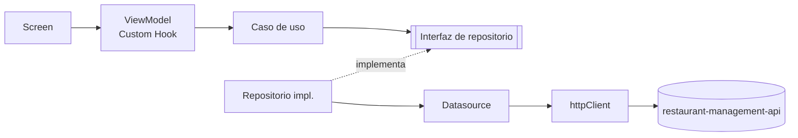
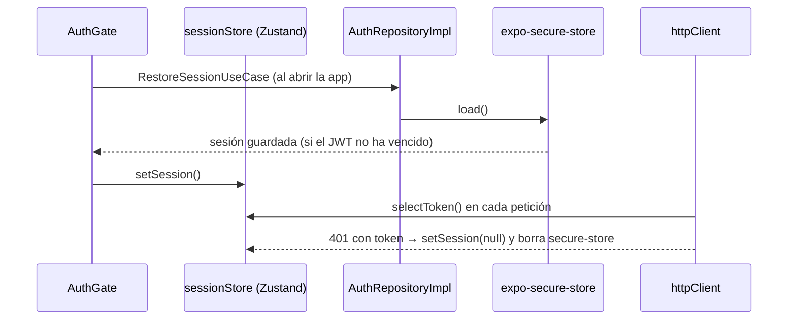

# Arquitectura de la app móvil

Clean Architecture por features + MVVM, acordada en pareja (Irving y José) en la tarea #310.

## Estructura

```text
src/
├── core/                         # Compartido por todas las features, sin lógica de negocio
│   ├── config/env.ts             # Variables EXPO_PUBLIC_* (todo lo de aquí va en el bundle)
│   ├── errors/AppError.ts        # Error de la app, independiente de HTTP
│   ├── http/httpClient.ts        # Singleton: única instancia que habla con el API e inyecta el JWT
│   ├── di/                       # Dependency Injection: grafo de dependencias + Context/Provider
│   ├── providers/AppProviders.tsx# QueryClientProvider + DependenciesProvider
│   └── monitoring/               # Sentry con filtrado de datos sensibles
├── shared/presentation/components/   # Componentes reutilizables (Card, ListItem, ...)
└── features/
    └── <feature>/                # auth, menu, reservations, orders, notifications, admin
        ├── domain/               # entities/, repositories/ (interfaces), usecases/
        ├── data/                 # datasources/, dtos/, mappers/, repositories/ (implementaciones), gateways/
        └── presentation/         # screens/, components/, viewmodels/ (Custom Hooks)
```

## Regla de dependencias



- `presentation → domain ← data`. El dominio no importa nada de `data/` ni de `presentation/`.
- `domain/` no importa React, Expo, `fetch` ni SDKs externos (Stripe, Expo Notifications). Así los
  casos de uso se prueban con Jest sin mocks de librerías.
- Un **Screen** solo renderiza y llama a su **ViewModel**. Nunca importa un caso de uso, un
  repositorio ni `httpClient` directamente.
- Un **ViewModel** es un Custom Hook (`useLogin`, `useMenu`, ...). Obtiene los casos de uso con
  `useDependencies()` y usa React Query (datos del servidor) o Zustand (estado local).
- Los **DTOs** (forma del JSON del API) no salen de `data/`. El **mapper** los convierte en
  entidades de dominio y descarta los campos que la app no necesita.
- Los errores llegan a dominio y presentación como `AppError` (`kind`: `unauthorized`,
  `validation`, `network`, ...), nunca como `Response` ni como códigos HTTP sueltos.

## Dependency Injection

`src/core/di/dependencies.ts` arma el grafo real de la app. Cada feature agrega ahí sus casos de uso:

```ts
export interface Dependencies {
  httpClient: HttpClient;
  loginUseCase: LoginUseCase; // HU-01
}

export function createDependencies(): Dependencies {
  const authRepository = new AuthRepositoryImpl(new AuthRemoteDataSource(httpClient), secureStorage);
  return { httpClient, loginUseCase: new LoginUseCase(authRepository) };
}
```

En pruebas se inyectan mocks sin tocar componentes:

```tsx
render(
  <AppProviders dependencies={{ ...mocks, loginUseCase: { execute: jest.fn() } }}>
    <LoginScreen />
  </AppProviders>,
);
```

## Manejo de estado

| Herramienta | Para qué | Ejemplo |
|---|---|---|
| React Query | Datos del servidor (caché, reintentos, invalidación) | menú, reservaciones, historial |
| Zustand | Estado local que debe sobrevivir al caché | sesión y rol, pedido en curso, permiso de notificaciones |

## Sesión (HU-01)



- `features/auth/presentation/store/sessionStore.ts` guarda `status` (`checking`,
  `authenticated`, `unauthenticated`) y la sesión (`token` + `user` con su `role`).
- `useLogin` usa `useMutation` solo para la llamada; el resultado va a Zustand y a secure-store.
- `useSessionBootstrap` (en `AuthGate`) conecta el `httpClient` con el store y lo hidrata al abrir la app.
- No hay refresh token: un 401 en una petición con token cierra la sesión y limpia el caché de React Query.
- Credenciales inválidas siempre muestran `Correo o contraseña incorrectos.` aunque el API
  distinga correo y contraseña. Un usuario con rol 5 (cliente) no puede entrar.
- `SignedInScreen` es temporal: HU-02 la reemplaza por la navegación según el rol.

## Pruebas (TDD)

- Las pruebas viven junto al código en `__tests__/` (`src/features/auth/domain/__tests__/LoginUseCase.test.ts`).
- Orden: caso de uso → repositorio/mapper → ViewModel → Screen.
- `httpClient` se prueba con un `fetch` falso (`fetchFn`). Los datasources se prueban con un
  `HttpClient` falso, y los casos de uso con un repositorio falso.

## Seguridad

- `httpClient` rechaza URLs sin HTTPS fuera de desarrollo (MASVS-NETWORK).
- El JWT vive solo en `expo-secure-store` con `WHEN_UNLOCKED_THIS_DEVICE_ONLY` (HU-01) y solo
  `httpClient` lo agrega a los headers. La app no usa AsyncStorage.
- Sentry filtra tokens, correos y datos personales (`src/core/monitoring/scrub.ts`).
- En `EXPO_PUBLIC_*` nunca va un secreto: termina en el bundle del APK.
