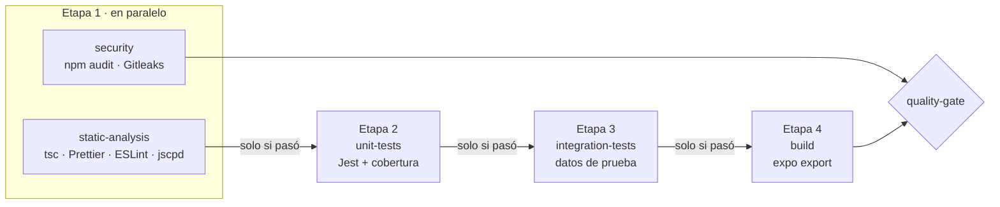

# CI/CD

## Workflows

| Workflow | Cuándo corre | Qué hace |
|---|---|---|
| `ci.yml` | Cada push y PR hacia `main`, `develop` y `release/**` | Pipeline de calidad por etapas; termina en el check `quality-gate` |
| `codeql.yml` | Cada push y PR, y los lunes | SAST de GitHub; publica el check `CodeQL` y las alertas en Security |
| `cd-preview.yml` | Tag `sprint-*` | APK de prueba con EAS (perfil `preview`) |
| `cd-release.yml` | Tag `v*` en `main` | APK firmado y GitHub Release en borrador |
| `cd-play-store.yml` | Tag `v*` en `main` (sin `-rc`) | AAB firmado y subida a Google Play, pista de pruebas internas |
| `dependabot.yml` | Lunes | PRs de actualización de npm y GitHub Actions |
| `project-*.yml` | Diario y al abrir PRs | Mantienen el tablero del proyecto |

## Pipeline de calidad: ¿en paralelo o en secuencia?

Las dos cosas, a propósito:

- **Etapa 1 en paralelo.** El análisis estático y el de seguridad no dependen uno del otro, así que corren
  al mismo tiempo para dar retroalimentación rápida.
- **Etapas 2, 3 y 4 en secuencia.** Cada job declara `needs:` sobre el anterior y solo arranca si ese
  terminó en verde. Si el análisis estático falla, las pruebas se marcan como *skipped* y no se gastan
  minutos en probar código que ya no cumple el estándar (*fail fast*).
- **Dentro de cada etapa de pruebas**, Jest reparte los archivos de prueba entre los núcleos del runner
  (workers en paralelo); las pruebas de un mismo archivo corren en secuencia.

## Cómo actúa el pipeline según el resultado

| Situación | Qué pasa |
|---|---|
| Un error de tipos, de formato o de ESLint, o un warning | `static-analysis` falla, las etapas 2–4 quedan en *skipped* y `quality-gate` reprueba |
| Una prueba unitaria falla o baja la cobertura del umbral | `unit-tests` falla, integración y build quedan en *skipped*, `quality-gate` reprueba |
| Una prueba de integración falla | `integration-tests` falla, build en *skipped*, `quality-gate` reprueba |
| El bundle no compila | `build` falla y `quality-gate` reprueba |
| Vulnerabilidad High o un secreto en el historial | `security` falla y `quality-gate` reprueba (las pruebas sí corren) |
| Todo en verde | `quality-gate` aprueba y el PR se puede mergear (con la aprobación de un revisor) |
| Tag `sprint-*` o `v*` sobre un commit con `quality-gate` en rojo | Los workflows de CD abortan y no generan APK ni AAB |

`quality-gate` siempre corre (`if: always()`) y deja una tabla con el resultado de cada etapa en la pestaña
**Summary** del run. Las etapas de pruebas también publican cuántas pruebas pasaron y la cobertura, y
suben los reportes como artefactos (30 días).

## Protección de ramas (Settings → Rules)

En `main` y `develop`:
- Checks obligatorios: **`quality-gate`** y **`CodeQL`**.
- 1 aprobación de un revisor distinto al autor.
- "Code scanning results": bloquear con alertas High o más.

## Cómo comprobar que el pipeline frena un error

1. Crear una rama desde `develop` y agregar un error a propósito, por ejemplo una variable sin usar en
   `src/shared/utils/formatCurrency.ts`.
2. Abrir un PR a `develop`.
3. Resultado esperado: `static-analysis` en rojo, `unit-tests`, `integration-tests` y `build` en *skipped*,
   `quality-gate` en rojo y el botón de merge bloqueado.
4. Cerrar el PR sin mergear y borrar la rama.

Lo mismo con una prueba que falle (por ejemplo, cambiar un `toBe(2)` por `toBe(3)`): `static-analysis` pasa,
`unit-tests` falla y lo demás se salta.
