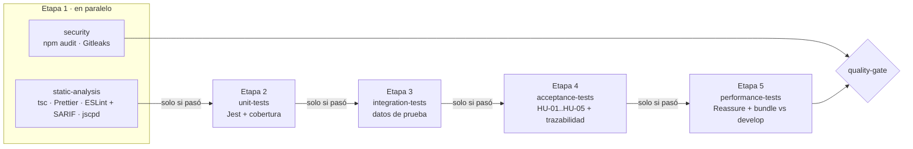

# CI/CD

## Workflows

| Workflow | Cuándo corre | Qué hace |
|---|---|---|
| `ci.yml` | Cada push y PR hacia `main`, `develop` y `release/**` | Pipeline de calidad por etapas (estático → unitarias → integración → aceptación → rendimiento); termina en el check `quality-gate` |
| `stress-tests.yml` | A mano, cada noche (09:17 UTC) y en PRs hacia `main` y `release/**` | Pruebas de esfuerzo contra el API falso; publica `stress-report` |
| `codeql.yml` | Cada push y PR, y los lunes | SAST de GitHub; publica el check `CodeQL` y las alertas en Security |
| `cd-preview.yml` | Tag `sprint-*` | APK de prueba con EAS (perfil `preview`) |
| `cd-release.yml` | Tag `v*` en `main` | APK firmado y GitHub Release en borrador |
| `dependabot.yml` | Lunes | PRs de actualización de npm y GitHub Actions |
| `project-*.yml` | Diario y al abrir PRs | Mantienen el tablero del proyecto |

## Pipeline de calidad: ¿en paralelo o en secuencia?

Las dos cosas, a propósito:

- **Etapa 1 en paralelo.** El análisis estático y el de seguridad no dependen uno del otro, así que corren
  al mismo tiempo para dar retroalimentación rápida. CodeQL también corre en paralelo (`codeql.yml`).
- **Etapas 2 a 5 en secuencia.** Todas viven en `ci.yml` porque `needs:` solo encadena jobs del mismo
  workflow. Cada una declara `needs:` sobre la anterior y solo arranca si esa terminó en verde. Si el
  análisis estático falla, las pruebas se marcan como *skipped* y no se gastan minutos (*fail fast*).
- **Dentro de cada etapa de pruebas**, Jest reparte los archivos de prueba entre los núcleos del runner
  (workers en paralelo); las pruebas de un mismo archivo corren en secuencia. Rendimiento y esfuerzo
  corren en serie (`--runInBand`) para que una medición no le robe CPU a otra.

### Reportes de cada etapa

| Etapa | Artefacto (30 días) | En el Summary del run | Otros |
|---|---|---|---|
| static-analysis | `static-analysis-report`: `tsc.txt`, `prettier.txt`, `eslint.json`, `eslint.sarif`, `jscpd/` (HTML y JSON), `summary.md` | Tabla con el resultado de cada herramienta | SARIF en Security → Code scanning (categoría `eslint`) |
| unit-tests | `unit-tests-report`: `coverage/` (lcov), `jest-unit.json` | Pruebas y cobertura | — |
| integration-tests | `integration-tests-report`: `jest-integration.json` | Pruebas | — |
| acceptance-tests | `acceptance-report`: `junit.xml`, `traceability.md`, `traceability.json` | Matriz HU \| criterio \| prueba \| resultado | — |
| performance-tests | `performance-report`: `output.md`, `output.json` (Reassure), `thresholds.json`, `summary.md`, `bundle-*.json`, rondas `.perf` | Tabla contra la línea base | — |
| stress-tests (otro workflow) | `stress-report`: `stress-report.json`, `stress-report.md` | Carga, métricas, límites y recuperación | — |

## Cómo actúa el pipeline según el resultado

| Situación | Qué pasa |
|---|---|
| Un error de tipos, de formato, de duplicación o de ESLint, o un warning | `static-analysis` sube su informe y falla; las etapas 2–5 quedan en *skipped* y `quality-gate` reprueba |
| Una prueba unitaria falla o baja la cobertura del umbral | `unit-tests` falla, las etapas 3–5 quedan en *skipped*, `quality-gate` reprueba |
| Una prueba de integración falla | `integration-tests` falla, aceptación y rendimiento en *skipped*, `quality-gate` reprueba |
| Un criterio de aceptación falla, una prueba no tiene ID o un criterio no tiene prueba | `acceptance-tests` falla, rendimiento en *skipped*, `quality-gate` reprueba |
| Una pantalla renderiza más lento (+10 %), con más renders, o el bundle crece +5 % | `performance-tests` falla y `quality-gate` reprueba |
| El bundle no compila | `performance-tests` falla en el `expo export` y `quality-gate` reprueba |
| Una operación rebasa su p95, el heap crece de más o la app no se recupera de una falla | `stress-tests` falla (bloquea los PRs hacia `main` y `release/**`) |
| Vulnerabilidad High o un secreto en el historial | `security` falla y `quality-gate` reprueba (las pruebas sí corren) |
| Todo en verde | `quality-gate` aprueba y el PR se puede mergear (con la aprobación de un revisor) |
| Tag `sprint-*` o `v*` sobre un commit con `quality-gate` en rojo | Los workflows de CD abortan y no generan APK ni AAB |

`quality-gate` siempre corre (`if: always()`) y deja una tabla con el resultado de cada etapa en la pestaña
**Summary** del run. Las etapas de pruebas también publican cuántas pruebas pasaron y la cobertura, y
suben los reportes como artefactos (30 días).

## Protección de ramas (Settings → Rules)

En `main` y `develop`:
- Checks obligatorios: **`quality-gate`** y **`CodeQL`**.
- 1 aprobación de un revisor distinto al autor.
- "Code scanning results": bloquear con alertas High o más.

## Cómo comprobar que el pipeline frena un error

1. Crear una rama desde `develop` y agregar un error a propósito, por ejemplo una variable sin usar en
   `src/shared/utils/formatCurrency.ts`.
2. Abrir un PR a `develop`.
3. Resultado esperado: `static-analysis` en rojo (con su informe subido), `unit-tests`, `integration-tests`,
   `acceptance-tests` y `performance-tests` en *skipped*, `quality-gate` en rojo y el botón de merge bloqueado.
4. Cerrar el PR sin mergear y borrar la rama.

Lo mismo con una prueba que falle (por ejemplo, cambiar un `toBe(2)` por `toBe(3)`): `static-analysis` pasa,
`unit-tests` falla y lo demás se salta.
