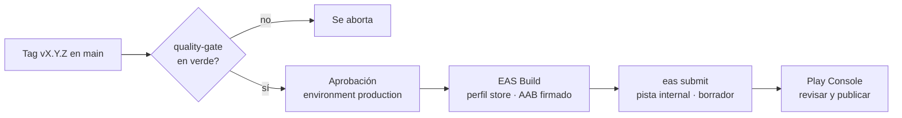

# Despliegue en Google Play

## Cómo se distribuye la app hoy y con Google Play

| Canal | Workflow | Artefacto | Para qué |
|---|---|---|---|
| APK de prueba por sprint | `cd-preview.yml` (tag `sprint-*`) | APK (perfil `preview`) | Pruebas de aceptación de cada sprint, se instala a mano |
| Release firmada | `cd-release.yml` (tag `v*`) | APK firmado + GitHub Release en borrador | Entrega formal y respaldo instalable |
| **Google Play** | `cd-play-store.yml` (tag `vX.Y.Z` en `main`) | **AAB** firmado (perfil `store`) | Distribución por la tienda, con actualizaciones automáticas |

Google Play solo acepta **Android App Bundle (.aab)**, no APK. Por eso el perfil `store` de `eas.json`
compila un AAB (`buildType: app-bundle`) y `cd-release` sigue generando el APK para instalar a mano.

## Firma y versiones

- **Firma.** EAS guarda el keystore del proyecto y firma cada build. En Play se activa **Play App Signing**:
  Google guarda la llave de firma final y el keystore de EAS queda como *upload key*. Si se pierde la upload
  key, Google permite cambiarla; la llave de firma no se pierde.
- **versionCode.** `eas.json` usa `appVersionSource: remote` y `autoIncrement: true`, así cada build sube el
  `versionCode` y Play nunca rechaza una versión repetida. El `version` visible (1.0.0) se cambia en `app.json`.

## Pistas de Google Play

| Pista | Quién la ve | Uso en el proyecto |
|---|---|---|
| Pruebas internas (`internal`) | Hasta 100 testers por correo, sin revisión de Google | A donde sube `cd-play-store.yml` en cada versión |
| Pruebas cerradas | Lista de testers, con revisión | Requisito para cuentas personales nuevas (ver abajo) |
| Producción | Público o la organización | Al terminar el proyecto, si se decide publicar |

Como la app es **solo para el personal del restaurante**, la pista interna o cerrada puede ser la
distribución final: no hace falta publicarla en producción para el público.

## Configuración (una sola vez, la hace José)

1. **Cuenta de Google Play Console.** Pago único de 25 USD y verificación de identidad.
   Las cuentas **personales** nuevas deben hacer una prueba cerrada con al menos **12 testers durante 14 días**
   antes de poder pedir acceso a producción. Las cuentas de organización no tienen ese requisito.
2. **Crear la app** en Play Console con el paquete `com.ijstudio.restaurantmanagement` (el de `app.json`).
3. **Primera subida manual.** Google exige que el primer AAB se suba a mano:
   - `eas build --platform android --profile store` (o lanzar el workflow con un tag).
   - Descargar el `.aab` desde expo.dev y subirlo en Play Console → Testing → Internal testing → Create release.
   - Aceptar Play App Signing.
4. **Cuenta de servicio para subir desde CI.**
   - En Google Cloud Console: crear una cuenta de servicio y una llave **JSON**.
   - En Play Console → Users and permissions: invitar el correo de la cuenta de servicio con permiso de
     **Release to testing tracks** solo para esta app.
5. **Secreto en GitHub.** Settings → Secrets and variables → Actions → New secret
   `GOOGLE_SERVICE_ACCOUNT_KEY` con el contenido completo del JSON. Nunca se sube el archivo al repo:
   está en `.gitignore` y Gitleaks lo bloquearía.
6. **Ficha y políticas.** Antes de cualquier revisión de Google:
   - Política de privacidad (URL pública): la app guarda correo, nombre y rol del personal, y datos de clientes en reservaciones.
   - Formulario **Data safety**: datos que se recogen (correo, nombre, teléfono de clientes), cifrado en tránsito (HTTPS) y sin compartir con terceros.
   - Clasificación de contenido y público objetivo (adultos, uso laboral).
7. **Testers.** En la pista interna, agregar los correos de Irving, José y el dueño.

## Publicar una versión

1. Mergear `release/vX.Y.Z` a `main`.
2. Crear y subir el tag: `git tag vX.Y.Z && git push origin vX.Y.Z`.
3. Aprobar el despliegue en Actions (environment `production`).
4. `cd-release` genera el APK y la GitHub Release en borrador; `cd-play-store` sube el AAB a la pista interna.
5. En Play Console, revisar la versión en borrador y darle **Start rollout**. Los testers la reciben por la tienda.

Si falta `GOOGLE_SERVICE_ACCOUNT_KEY`, `cd-play-store` termina con un aviso y no publica nada; lo demás sigue igual.

## Checklist antes de la primera publicación

- [ ] `EXPO_PUBLIC_API_URL` de producción con HTTPS.
- [ ] `android.allowBackup` y `debuggable` revisados en el APK (MobSF, issue de release).
- [ ] Ícono, nombre visible y capturas de pantalla para la ficha.
- [ ] Política de privacidad publicada y formulario Data safety completo.
- [ ] Prueba en al menos un Android real instalado desde la pista interna.
