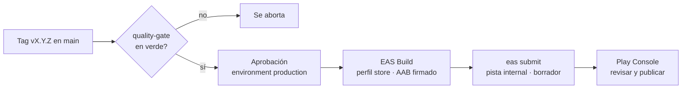

# Despliegue en Google Play

## Cómo se distribuye la app hoy y con Google Play

| Canal | Workflow | Artefacto | Para qué |
|---|---|---|---|
| APK de prueba por sprint | `cd-preview.yml` (tag `sprint-*`) | APK (perfil `preview`) | Pruebas de aceptación de cada sprint, se instala a mano |
| Release firmada | `cd-release.yml` (tag `v*`) | APK firmado + GitHub Release en borrador | Entrega formal y respaldo instalable |
| **Google Play** | `cd-play-store.yml` (tag `vX.Y.Z` en `main`) | **AAB** firmado (perfil `store`) | Distribución por la tienda, con actualizaciones automáticas |

Google Play solo acepta **Android App Bundle (.aab)**, no APK. Por eso el perfil `store` de `eas.json`
compila un AAB (`buildType: app-bundle`) y `cd-release` sigue generando el APK para instalar a mano.
El perfil `store` hereda de `production` (mismo entorno de EAS, mismo `versionCode` autoincremental) y la
subida usa el perfil de envío `production` de `eas.json` (`submit.production.android`: pista `internal`,
estado `draft`).

## Firma y versiones

- **Firma.** EAS guarda el keystore del proyecto y firma cada build. En Play se activa **Play App Signing**:
  Google guarda la llave de firma final y el keystore de EAS queda como *upload key*. Si se pierde la upload
  key, Google permite cambiarla; la llave de firma no se pierde.
- **versionCode.** `eas.json` usa `appVersionSource: remote` y `autoIncrement: true`, así cada build sube el
  `versionCode` y Play nunca rechaza una versión repetida. El `version` visible (1.0.0) se cambia en `app.json`.

## Secretos y variables que necesita el despliegue

Ninguno vive en el repositorio. Se configuran en GitHub (**Settings → Secrets and variables → Actions**)
o en EAS (**expo.dev → proyecto → Credentials / Environment variables**).

| Nombre | Dónde | Estado | Para qué |
|---|---|---|---|
| `EXPO_TOKEN` | GitHub · Secret | Ya existe (lo usan `cd-preview` y `cd-release`) | Iniciar sesión en EAS desde el runner |
| `GOOGLE_SERVICE_ACCOUNT_KEY` | GitHub · Secret | **Falta** | JSON de la cuenta de servicio con permiso para subir a las pistas de prueba. Sin él, `cd-play-store` se salta la publicación con un aviso |
| `SENTRY_AUTH_TOKEN` | GitHub · Secret | Ya existe (configurado para `cd-preview`) | Subir los source maps del AAB a Sentry. Si falta, solo se avisa |
| `EXPO_PUBLIC_SENTRY_DSN` | GitHub · Variable | Ya existe (configurada para `cd-preview`) | Sentry dentro de la app. Si falta, la app va con Sentry apagado |
| `EXPO_PUBLIC_API_URL` | EAS · entorno `production` | Revisar | URL **HTTPS** del API en producción; sin HTTPS la app rechaza las peticiones |
| Llave de FCM (V1) | EAS · Credentials → Android → FCM V1 service account key | **Falta** | Las notificaciones push (`expo-notifications`) no llegan en un build de Android sin ella |
| Environment `production` | GitHub · Settings → Environments | Verificar que exista y tenga *Required reviewers* (lo usa también `cd-release`) | Alguien aprueba antes de compilar y publicar |

## Notificaciones push en el build de Play

La app usa `expo-notifications` (HU-07). En Expo Go las push funcionan con la infraestructura de Expo,
pero en un AAB propio Android las entrega por **Firebase Cloud Messaging**:

1. Crear un proyecto en Firebase con el paquete de Android `quijote.mobile`.
2. En Google Cloud, crear una cuenta de servicio con el rol *Firebase Cloud Messaging API Admin* y una llave JSON.
3. Subirla a EAS: `eas credentials` → Android → `production` → Google Service Account → *FCM V1*.
   (Es otra llave distinta de `GOOGLE_SERVICE_ACCOUNT_KEY`: una es para FCM y la otra para subir a Play.)
4. Declarar en el formulario **Data safety** que la app guarda el token del dispositivo para enviar avisos.

## Pistas de Google Play

| Pista | Quién la ve | Uso en el proyecto |
|---|---|---|
| Pruebas internas (`internal`) | Hasta 100 testers por correo, sin revisión de Google | A donde sube `cd-play-store.yml` en cada versión |
| Pruebas cerradas | Lista de testers, con revisión | Requisito para cuentas personales nuevas (ver abajo) |
| Producción | Público o la organización | Al terminar el proyecto, si se decide publicar |

Como la app es **solo para el personal del restaurante**, la pista interna o cerrada puede ser la
distribución final: no hace falta publicarla en producción para el público.

## Configuración (una sola vez, la hace José)

1. **Cuenta de Google Play Console.** Pago único de 25 USD y verificación de identidad.
   Las cuentas **personales** nuevas deben hacer una prueba cerrada con al menos **12 testers durante 14 días**
   antes de poder pedir acceso a producción. Las cuentas de organización no tienen ese requisito.
2. **Crear la app** en Play Console con el paquete `quijote.mobile` (el de `app.json`, `android.package`). Google lo fija al crear la app y no se puede cambiar.
3. **Primera subida manual.** Google exige que el primer AAB se suba a mano:
   - `eas build --platform android --profile store` (o lanzar el workflow con un tag).
   - Descargar el `.aab` desde expo.dev y subirlo en Play Console → Testing → Internal testing → Create release.
   - Aceptar Play App Signing.
4. **Cuenta de servicio para subir desde CI.**
   - En Google Cloud Console: crear una cuenta de servicio y una llave **JSON**.
   - En Play Console → Users and permissions: invitar el correo de la cuenta de servicio con permiso de
     **Release to testing tracks** solo para esta app.
5. **Secreto en GitHub.** Settings → Secrets and variables → Actions → New secret
   `GOOGLE_SERVICE_ACCOUNT_KEY` con el contenido completo del JSON. Nunca se sube el archivo al repo:
   está en `.gitignore` y Gitleaks lo bloquearía.
6. **Ficha y políticas.** Antes de cualquier revisión de Google:
   - Política de privacidad (URL pública): la app guarda correo, nombre y rol del personal, y datos de clientes en reservaciones.
   - Formulario **Data safety**: datos que se recogen (correo, nombre, teléfono de clientes, token del dispositivo para notificaciones), cifrado en tránsito (HTTPS) y sin compartir con terceros.
   - Clasificación de contenido y público objetivo (adultos, uso laboral).
7. **Testers.** En la pista interna, agregar los correos de Irving, José y el dueño.

## Publicar una versión

1. Mergear `release/vX.Y.Z` a `main`.
2. Crear y subir el tag: `git tag vX.Y.Z && git push origin vX.Y.Z`.
3. Aprobar el despliegue en Actions (environment `production`).
4. `cd-release` genera el APK y la GitHub Release en borrador; `cd-play-store` sube el AAB a la pista interna.
5. En Play Console, revisar la versión en borrador y darle **Start rollout**. Los testers la reciben por la tienda.

Si falta `GOOGLE_SERVICE_ACCOUNT_KEY`, `cd-play-store` termina con un aviso y no publica nada; lo demás sigue igual.

## Checklist antes de la primera publicación

Los textos de la ficha, el cuestionario de contenido y las respuestas de «Seguridad de los datos» están
en [`google-play-ficha.md`](google-play-ficha.md) y [`google-play-seguridad-datos.md`](google-play-seguridad-datos.md).

- [ ] `EXPO_PUBLIC_API_URL` de producción con HTTPS, en el entorno `production` de EAS.
- [ ] Llave de FCM V1 subida a EAS y una notificación de prueba recibida en un Android real.
- [x] `android.allowBackup` y `debuggable` revisados en el APK: [`reporte-ofuscacion-jadx.md`](reporte-ofuscacion-jadx.md) (la auditoría con MobSF sigue en el issue de release).
- [ ] Ícono, nombre visible y capturas de pantalla para la ficha.
- [ ] Política de privacidad publicada y formulario Data safety completo.
- [ ] Prueba en al menos un Android real instalado desde la pista interna.
