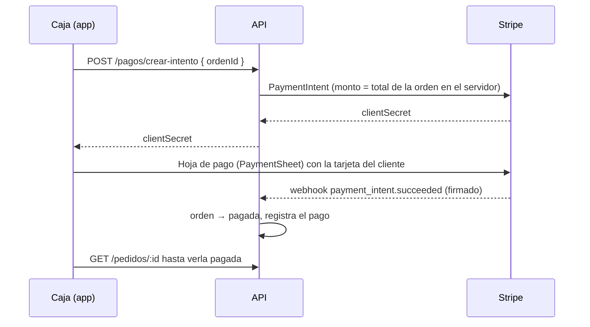

# Cobro con tarjeta (Stripe)

Caja puede cobrar la cuenta completa de una mesa con tarjeta desde la app (HU-05, #338–#341), además de
efectivo o la terminal física. Todo en **modo de prueba** de Stripe.

## Cómo funciona

| Pieza | Archivo | Patrón |
|---|---|---|
| Puerto | `src/features/orders/domain/ports/PaymentGateway.ts` | — |
| Adapter de Stripe | `src/features/orders/data/gateways/StripePaymentGateway.ts` | Adapter |
| Fachada `checkout()` | `src/features/orders/domain/usecases/CheckoutUseCase.ts` | Facade |
| ViewModel y botón | `useCardCheckout.ts`, «Cobrar con tarjeta en la app» en `ChargeScreen` | MVVM |

- Solo se ofrece para la **cuenta completa** y sin pagos previos: la intención cobra el total.
- La app nunca decide el monto ni da el pedido por pagado: lo hace el API al recibir el webhook. Si el
  webhook tarda, la app lo dice y no muestra el pago como confirmado.
- La opción solo aparece si el build tiene `EXPO_PUBLIC_STRIPE_PUBLISHABLE_KEY` con una llave `pk_…`.

## Pruebas de seguridad (#341)

| Riesgo | Control | Evidencia |
|---|---|---|
| Monto manipulado desde la app | El API calcula el monto del total guardado; la app solo manda `ordenId` | API `pagos.service.spec.ts` (monto en centavos del servidor); aceptación HU-05 CA-1 revisa el cuerpo de `crear-intento` |
| Cobrar de más en una cuenta separada | El API rechaza la intención si ya hay pagos; la app no ofrece la opción | API `pagos.service.spec.ts`; `CheckoutUseCase.test.ts` |
| Webhook falso | Firma de Stripe obligatoria; firma inválida → 400 sin detalle | API `pagos.service.spec.ts` («firma inválida → 400 genérico») |
| Webhook repetido | Idempotencia por evento y por estatus de la orden | API («un evento repetido no vuelve a procesar la orden») |
| Llave secreta en el APK | Solo `EXPO_PUBLIC_STRIPE_PUBLISHABLE_KEY`; el adapter rechaza cualquier llave que no empiece con `pk_` | `StripePaymentGateway.test.ts`; búsqueda en el bundle exportado (abajo) |
| Datos de la tarjeta en la app | La hoja de pago de Stripe los captura; nunca pasan por el código de la app | Diseño del SDK |

**Bundle sin secretos** (13-nov): `npx expo export --platform android` y búsqueda de
`sk_live_`, `sk_test_`, `whsec_`, `rk_live_` y `service_role` en todo el export: **0 coincidencias**; la
llave pública sí está (es pública por diseño). Gitleaks revisa además el repositorio en cada PR.

## Pruebas (TDD, #339)

- `CheckoutUseCase.test.ts`: éxito, tarjeta rechazada, cancelación, red caída, webhook que tarda, pagos
  parciales y pedido sin saldo, con un mock del adapter.
- `StripePaymentGateway.test.ts`: con el mock oficial del SDK.
- Aceptación HU-05 CA-1 (pagado y sale de los cobros pendientes) y CA-2 (rechazo con el motivo).
- Pendiente en el teléfono: un cobro real en modo de prueba con la tarjeta `4242 4242 4242 4242`.
